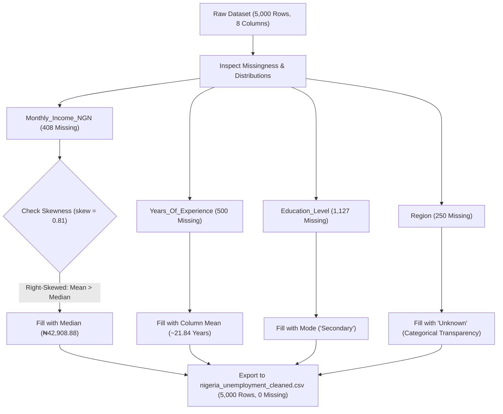

# Nigeria Unemployment Survey: Data Wrangling & Missing Value Imputation

[](https://www.python.org/)
[](https://pandas.pydata.org/)
[](https://numpy.org/)
[](https://jupyter.org/)
[](https://creativecommons.org/licenses/by-nc/4.0/)
[](#disclaimer)

---

## Author
**Eberechi Bessie Donalds**

---

## Disclaimer
> [!IMPORTANT]
> **Educational & Synthetic Dataset Notice:**  
> The dataset utilized in this project is a **synthetic dataset designed strictly for educational and training purposes**. While it realistically simulates demographic, employment, and income patterns in Nigeria—including common survey imperfections like non-random missingness—it does not represent verified census returns or official governmental statistics from the National Bureau of Statistics (NBS).

---

## Original Dataset Attribution & Source Credit
The raw dataset used in this repository was originally created and published by:

* **Original Author / Creator:** [Awofiranye James](https://www.kaggle.com/awofiranyejames)
* **Dataset Title:** Nigeria Unemployment Dataset
* **Platform:** Kaggle
* **License:** [Attribution-NonCommercial 4.0 International (CC BY-NC 4.0)](https://creativecommons.org/licenses/by-nc/4.0/)
* **Download URL:** [Download Raw Dataset on Kaggle](https://www.kaggle.com/datasets/awofiranyejames/nigeria-unemployment-dataset)

All credit for creating and releasing the base survey structure goes to Awofiranye James.

---

## Executive Summary
In data science, the *"garbage in, garbage out"* principle governs model reliability: algorithms are only as good as the data fed into them. Real-world survey datasets routinely suffer from missing entries due to non-response, skipping, or recording omissions.

This project demonstrates practical, statistically sound data wrangling workflows on a 5,000-record Nigerian labor survey. A naive deletion strategy (`dropna()`) would have discarded **1,982 rows (~39.64% of the dataset)**, causing significant sample loss and bias. Instead, this project analyzes feature distributions, measures skewness, and applies domain-appropriate imputation techniques across categorical, numerical, and skewed variables:
- **Zero data loss:** Preserved 100% of the 5,000 survey respondents.
- **Skew-aware imputation:** Applied median imputation to monthly income after establishing a positive skew of **0.81**, avoiding an artificial ₦15,200 inflation that mean imputation would have caused.
- **Categorical integrity:** Maintained explicit transparency for regional data by assigning `'Unknown'` rather than guessing locations, and populated missing education levels with the mode (`'Secondary'`).

---

## Repository Structure

```text
Data Wrangling/
├── Data Wrangling intro.ipynb            # Jupyter Notebook with step-by-step cleaning workflow
├── nigeria_unemployment_missing_data.csv # Raw synthetic survey dataset (contains missing values)
├── nigeria_unemployment_cleaned.csv      # Imputed, zero-null cleaned dataset
└── README.md                             # Documentation, methodology, and project guide
```

---

## Dataset Overview

The survey captures individual-level demographic and economic indicators across 5,000 respondents in Nigeria.

### Schema & Feature Dictionary

| Column Name | Data Type | Non-Null Count (Raw) | Missing Count (Raw) | Missing % (Raw) | Description / Observed Values |
| :--- | :---: | :---: | :---: | :---: | :--- |
| `Age` | `int64` | 5,000 | 0 | 0.00% | Respondent age in years (Range: 15 – 64, Mean: 39.67) |
| `Gender` | `object` (`str`) | 5,000 | 0 | 0.00% | Gender of respondent (`Male`: 2,537, `Female`: 2,463) |
| `Region` | `object` (`str`) | 4,750 | 250 | 5.00% | Geopolitical zone (North West, South West, North East, North Central, South South, South East) |
| `Location` | `object` (`str`) | 5,000 | 0 | 0.00% | Settlement type (`Urban`: 2,669, `Rural`: 2,331) |
| `Education_Level`| `object` (`str`) | 3,873 | 1,127 | 22.54% | Highest educational attainment (`Primary`, `Secondary`, `Tertiary`) |
| `Employment_Status` | `object` (`str`) | 5,000 | 0 | 0.00% | Status (`Underemployed`: 2,206, `Employed`: 1,818, `Unemployed`: 976) |
| `Years_Of_Experience` | `float64` | 4,500 | 500 | 10.00% | Cumulative work experience in years (Range: 0.0 – 49.0, Mean: 21.84) |
| `Monthly_Income_NGN` | `float64` | 4,592 | 408 | 8.16% | Monthly income in Nigerian Naira (₦) (Range: ₦0 – ₦261,319.16) |

---

## Methodology & Imputation Strategy

The cleaning pipeline systematically addresses missing values by matching each column to its underlying distribution and data type:



### 1. Rejection of Naive Row Deletion (`dropna`)
- Executing `dropna()` would eliminate every record containing at least one missing field.
- In this dataset, 1,982 rows contain missing values. Deletion would shrink the sample from 5,000 to **3,018 rows**—a **39.64% loss of data**.
- Because missingness is non-trivial, imputation was selected to conserve statistical power and preserve valid data across unaffected columns.

### 2. Skewness Assessment & Median Imputation (`Monthly_Income_NGN`)
- **Distribution Metric:** The skewness was computed at **+0.81**, which indicates a moderately right-skewed distribution.
- **Mean vs. Median Gap:**
  - Mean Income: **₦58,114.54**
  - Median Income: **₦42,908.88**
  - Disparity: The mean is approximately **₦15,205.66 higher (~35.4% above the median)** due to high-earning outliers stretching the upper tail.
- **Decision:** Filling the 408 missing values with the mean would inject ₦58k into hundreds of records, artificially distorting typical earnings. Imputing with the **median (`42908.875`)** preserves realistic central tendency.

### 3. Mean Imputation (`Years_Of_Experience`)
- **Metric:** 500 entries (10.0%) were unrecorded.
- **Decision:** Work experience exhibits a balanced distribution around a mean of **~21.8353 years** (median: 22.0 years). Missing values were imputed using `fillna(mean_experience_value)`.

### 4. Mode Imputation & Analytical Discussion (`Education_Level`)
- **Metric:** 1,127 entries (22.54%) were null.
- **Decision:** Missing rows were imputed using the column mode (`'Secondary'`, which represents 1,763 known occurrences in raw data).
- **Quality Note:** As highlighted in the notebook, while mode imputation is common in predictive modeling, labeling missing categories as `'Unknown'` is an alternative method when absolute transparency about data collection gaps is required.

### 5. Explicit Categorical Imputation (`Region`)
- **Metric:** 250 entries (5.0%) were null.
- **Decision:** Geopolitical regions are nominal, non-ordinal categories where central tendency statistics cannot be applied. Missing values were explicitly assigned the label `'Unknown'` to prevent fabricating respondent origins.

---

## Key Findings & Data Insights

1. **Pre- and Post-Imputation Preserved Sample:**
   - Raw records: 5,000 | Cleaned records: 5,000 (0 records discarded).
   - Missing values reduced from 2,285 total null instances across 4 columns to **0**.
2. **Income Inequality Dynamics:**
   - Minimum income: ₦0.00 | Maximum income: ₦261,319.16.
   - The top 25% of earners make over ₦93,927.70, while 50% earn ₦42,908.88 or less.
3. **Employment Distribution:**
   - **Underemployed:** 2,206 respondents (44.12%)
   - **Employed:** 1,818 respondents (36.36%)
   - **Unemployed:** 976 respondents (19.52%)
4. **Geographic Distribution (Cleaned):**
   - North West: 1,146 (22.92%)
   - South West: 974 (19.48%)
   - North East: 744 (14.88%)
   - North Central: 727 (14.54%)
   - South South: 667 (13.34%)
   - South East: 492 (9.84%)
   - Unknown: 250 (5.00%)
5. **Next Steps Identified in Notebook:**
   - Outlier detection and treatment.
   - Verification and correction of variable data types.

---

## Tech Stack

- **Language:** Python 3.14.6
- **Data Manipulation:** `pandas`
- **Numerical Computations:** `numpy`
- **Interactive Environment:** `Jupyter Notebook` / `IPython`

---

## How to Run It

### Prerequisites
Make sure you have Python 3.9+ installed on your system.

### 1. Clone the Repository
```bash
git clone https://github.com/<your-username>/data-wrangling.git
cd data-wrangling
```

### 2. Set Up a Virtual Environment (Optional but Recommended)
On Windows (PowerShell):
```powershell
python -m venv venv
.\venv\Scripts\Activate.ps1
```

On macOS / Linux:
```bash
python3 -m venv venv
source venv/bin/activate
```

### 3. Install Required Dependencies
```bash
pip install pandas numpy jupyter
```

### 4. Launch the Jupyter Notebook
```bash
jupyter notebook "Data Wrangling intro.ipynb"
```

### 5. Reproduce the Cleaning Pipeline
Run all cells in the notebook from top to bottom (`Cell` -> `Run All`). The notebook will load `nigeria_unemployment_missing_data.csv`, perform the statistical assessments and imputations, and output the clean dataset to `nigeria_unemployment_cleaned.csv`.

---

## Author Information

- **Author:** Eberechi Bessie Donalds
- **Role:** Data Science & Analytics Enthusiast
